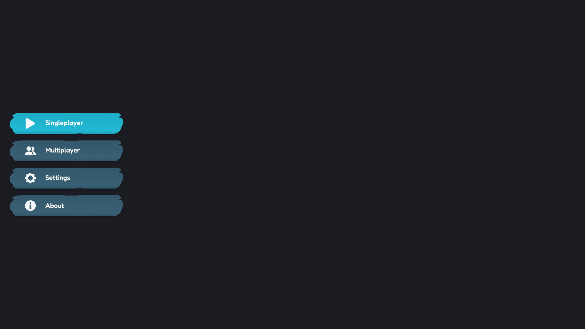
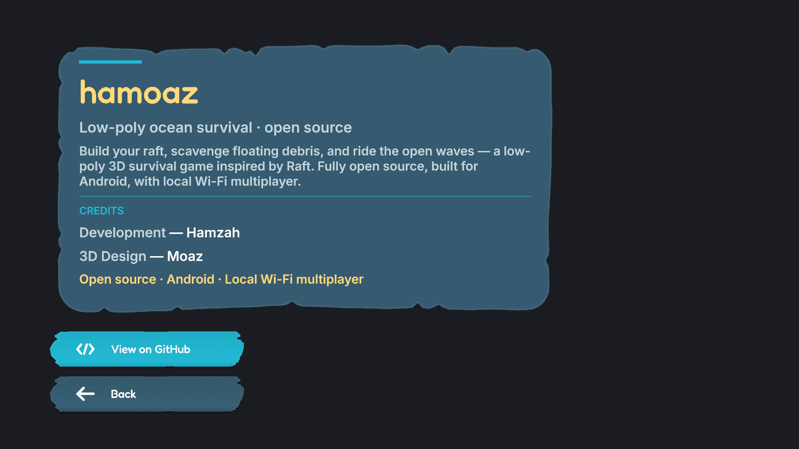

# hamoaz

A low-poly ocean survival game inspired by Raft. Build your raft, scavenge
floating debris, and ride the open waves — fully open source, built for
Android with local Wi-Fi multiplayer.

| Main menu | About |
| --- | --- |
|  |  |

## Status

Early development. The front-end is taking shape:

- [x] Main menu — cinematic ocean backdrop, brush-stroke buttons, scene navigation
- [x] About page — credits, GitHub link, responsive on every aspect ratio
- [ ] Singleplayer gameplay
- [ ] Local Wi-Fi multiplayer
- [ ] Settings
- [ ] Android release build

## Getting started

### Prerequisites

- **Unity 6 — 6000.6.5f1** (via [Unity Hub](https://unity.com/download)). Use
  the exact version to avoid unintended upgrade churn.
- Python 3 with [Pillow](https://python-pillow.org/) if you need to regenerate
  the UI sprites (`Tools/IconGenerator`).

### Open and run

1. Clone the repository and open the project folder in Unity Hub.
2. `Assets/Scenes/MainMenu.unity` and `Assets/Scenes/About.unity` are already
   registered in **Build Settings** (the builders keep them registered).
3. Press Play on the main menu — *About* opens the about page, *Back* returns.

### Rebuilding the UI

UI scenes are **code-generated**: edit the builder scripts, then run their menu
items (each builder is idempotent and re-saves the scene):

| Menu item | Script | Result |
| --- | --- | --- |
| `Tools → Build MainMenu Background` | `Assets/Editor/ApplyCinematicMenuLook.cs` | Ocean backdrop, camera, lighting, volume |
| `Tools → Build Main Menu Buttons` | `Assets/Editor/MainMenuUIBuilder.cs` | Menu canvas + `MainMenuButton` prefab |
| `Tools → Build About Scene` | `Assets/Editor/AboutUIBuilder.cs` | The about scene (card, credits, buttons) |

They also run headless, e.g.:

```sh
Unity -batchmode -quit -projectPath . \
  -executeMethod AboutUIBuilder.Build -logFile build.log
```

`MenuBuildTest` / `AboutBuildTest` additionally capture UI screenshots at
several resolutions for layout checks.

## Project layout

| Path | Purpose |
| --- | --- |
| `Assets/Scenes/` | `MainMenu.unity`, `About.unity` (generated by the builders) |
| `Assets/Editor/` | Scene builders + screenshot test harnesses |
| `Assets/Scripts/` | Runtime components (`SceneButton`, `ContainFitScale`, `SafeAreaFitter`, …) |
| `Assets/UI/Theme/` | `ui-palette.json` — color source of truth |
| `Assets/UI/Icons/` | UI icon pack + [style contract](Assets/UI/Icons/README.md) |
| `Assets/UI/Fonts/` | Fredoka (titles) and Inter (body), with TMP atlases |
| `Assets/Settings/` | URP assets, sea/sky materials, volume profile |
| `Tools/IconGenerator/` | Regenerates icons, brush strips, and panels (Python) |

## UI conventions

- **Don't hand-edit generated scenes.** Change the builder scripts instead and
  re-run their `Tools` menu item.
- **Colors are pre-compensated.** `Assets/UI/Theme/ui-palette.json` is the
  design source, but everything on this UI passes through ACES tonemapping plus
  a vignette, so builders use boosted hex values (documented at each call site
  in `MainMenuUIBuilder` / `AboutUIBuilder`, e.g. palette gold `#F5C451` →
  `#FFD97A`).
- **Icons follow one contract** — pure white glyphs, 256×256, ~226px ink,
  chunky rounded forms. See `Assets/UI/Icons/README.md` for details, then
  regenerate with:

  ```sh
  python3 Tools/IconGenerator/generate_icons.py          # rewrite sprites
  python3 Tools/IconGenerator/generate_icons.py --sheet  # contact sheet
  ```

## Input

[Input System](https://docs.unity3d.com/Packages/com.unity.inputsystem@latest)
actions live in `Assets/InputSystem_Actions.inputactions`: a `Player` map
(Move, Look, Jump, Attack, Interact, Crouch) and a `UI` map (Navigate,
Submit, Cancel) shared by menu navigation.

## Credits

- **Hamzah** — development
- **Moaz** — 3D design

Third-party assets: Fredoka and Inter fonts (SIL Open Font License 1.1),
TextMesh Pro (Unity Companion License).

## License

hamoaz is licensed under the **GNU General Public License v3.0** — see
[LICENSE](LICENSE) for the full text.
